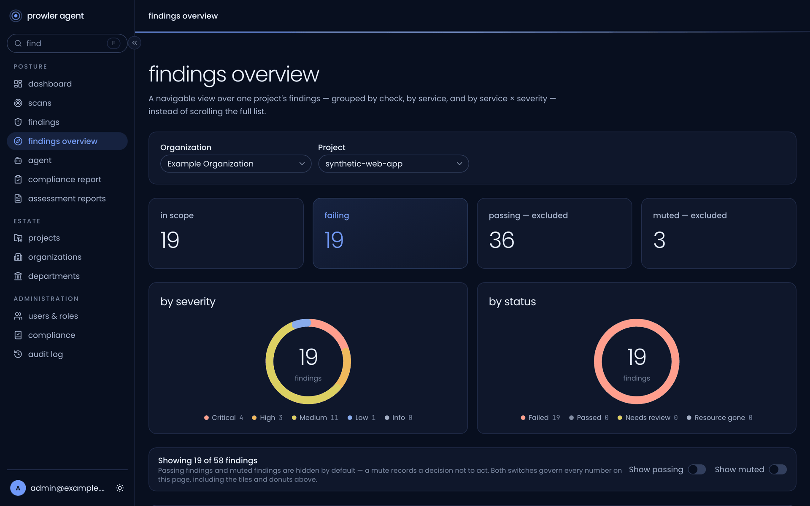
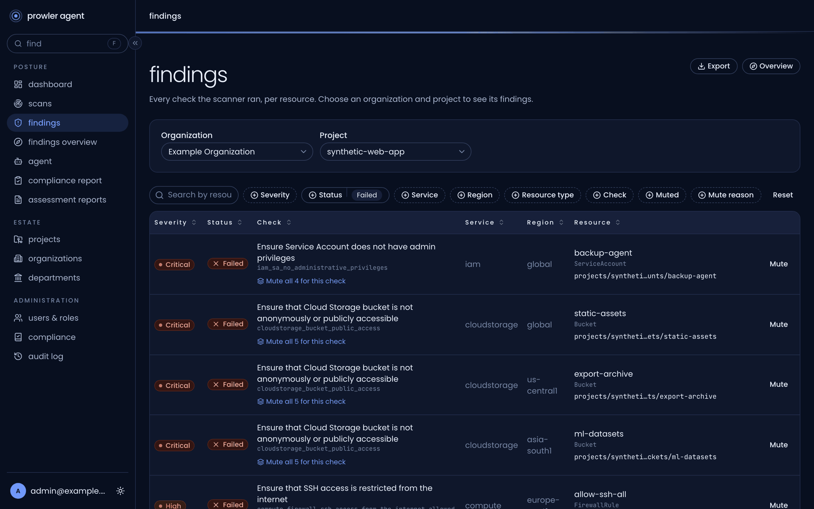
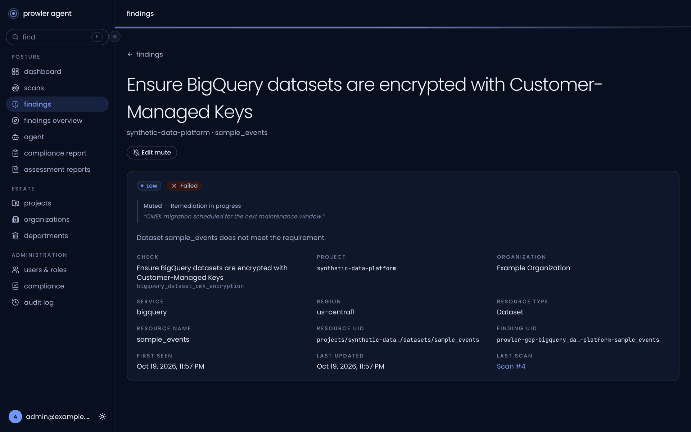
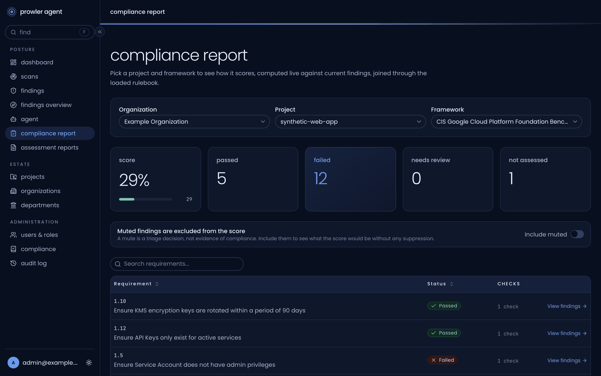
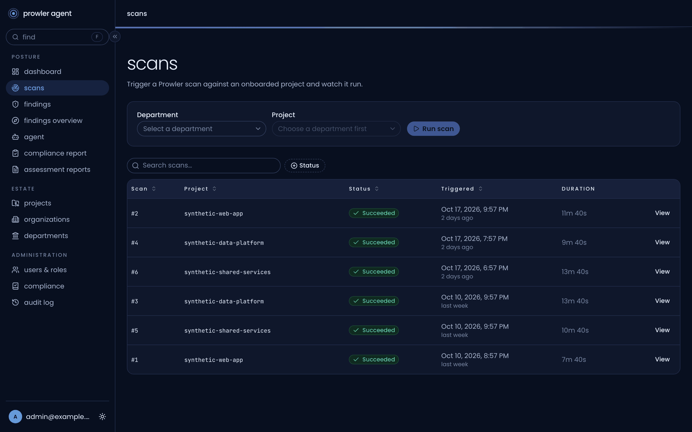
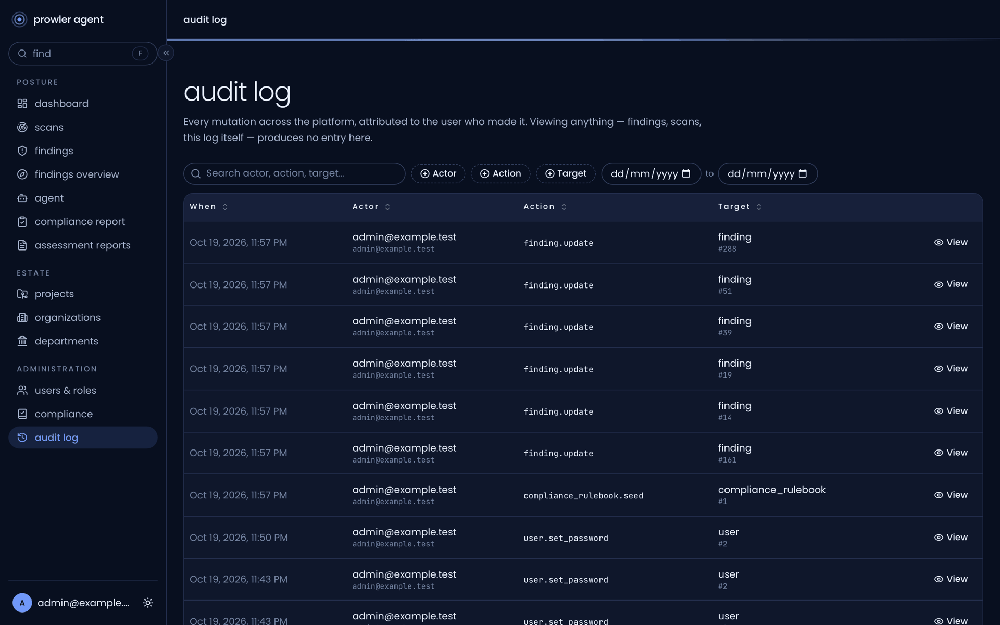
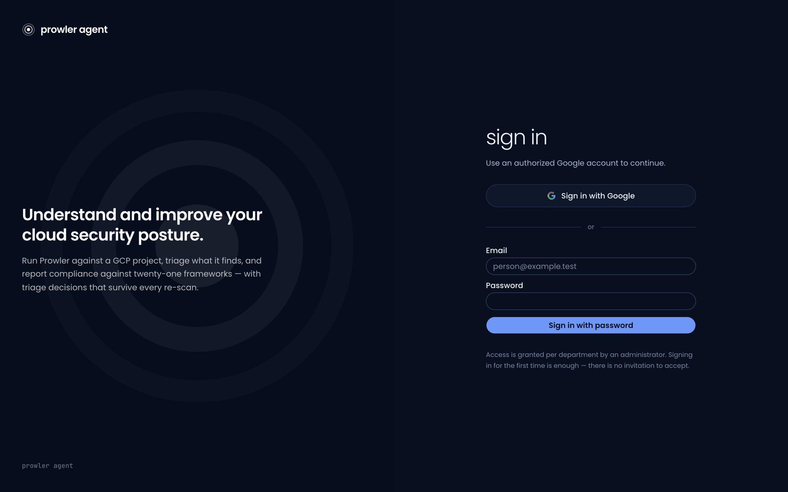

<h1 align="center">prowler agent</h1>

<p align="center"><strong>A self-hosted workspace for reviewing Google Cloud security findings.</strong></p>

<p align="center">
  <a href="https://github.com/a3harva/prowler-ai-agent/actions/workflows/ci.yml"></a>
  <a href="LICENSE"></a>
  
  
  
  
</p>

<p align="center">
  
</p>

prowler agent brings Prowler-compatible GCP scan results into one place so teams can review findings, track decisions across scans, map results to compliance frameworks, and produce assessment reports. It combines a React review console with a FastAPI API and background workers; optional integrations add Google sign-in, support-system context, AI-assisted reporting, observability, and read-only cloud investigation.

> **Project status:** Early-stage, self-hosted software. The supplied Docker Compose setup is for **trusted local development only**, not an internet-facing or production deployment. See [Security](#security-and-deployment-boundary) before running it.

## Why this project exists

A scan is a snapshot, not a review process. Security teams still need to decide which findings matter, assign owners, document exceptions, compare later scans, and communicate results to stakeholders. The goal of prowler agent is to make that review cycle repeatable and auditable while keeping operators in control of their scan data and optional external integrations. It is **not** an autonomous remediation tool or a substitute for validating scanner output and cloud permissions.

## What it does

- **Organize GCP scope:** onboard organizations and projects and record the service account used for scan impersonation.
- **Run and import scans:** launch Prowler GCP scans and ingest their CSV, OCSF JSON, HTML, and compliance exports into a reviewable findings inventory.
- **Triage findings:** assign, annotate, and mute findings with department-scoped Editor/Admin access; preserve review decisions across subsequent scans.
- **Track compliance:** roll up findings by the frameworks represented in the scanner's compliance exports.
- **Produce reports:** render PDF assessments, with optional AI-generated content and optional read-only live cloud context.
- **Maintain accountability:** record mutations in an audit trail.

## Screenshots

All screenshots use synthetic data (`synthetic-*` projects, `example.test` accounts).

<table>
  <tr>
    <td width="50%"><p align="center"><sub><b>Findings</b>: filter by severity, status, service, region and check; mute with a reason.</sub></p></td>
    <td width="50%"><p align="center"><sub><b>Finding detail</b>: resource context and the triage decision that survives re-scans.</sub></p></td>
  </tr>
  <tr>
    <td width="50%"><p align="center"><sub><b>Compliance report</b>: live score per framework, joined through the loaded rulebook.</sub></p></td>
    <td width="50%"><p align="center"><sub><b>Scans</b>: launch Prowler against an onboarded project and track each run.</sub></p></td>
  </tr>
  <tr>
    <td width="50%"><p align="center"><sub><b>Audit log</b>: every mutation, attributed to the user who made it.</sub></p></td>
    <td width="50%"><p align="center"><sub><b>Sign in</b>: Google OAuth, or local passwords for development.</sub></p></td>
  </tr>
</table>

Prowler is an independent project; prowler agent is **not affiliated with Prowler**. See [NOTICE](NOTICE).

## How it fits together

```text
Browser (React) → nginx → FastAPI → PostgreSQL
                         │
                         └→ Redis → Celery workers → Prowler scan container
                                                   → reports and findings
```

The API handles authentication and review workflows. Workers execute scans and report jobs; the scanner's output is stored locally and imported into PostgreSQL. Optional services include Google OAuth, Freshservice, Gemini, Langfuse, and a separate allowlisted read-only `gcloud`/`bq` context worker. See [architecture](docs/architecture.md) and the [threat model](docs/threat-model.md) for component and trust-boundary details.

## Get started locally

### Requirements

- Docker with the Compose plugin. On macOS, the scripts use Colima (4 CPUs / 8 GiB) when available; keep the checkout under `$HOME` for its bind mounts. Linux and Apple Silicon development hosts are supported.
- Python 3.12 and [`uv`](https://docs.astral.sh/uv/) for backend development; [Bun](https://bun.sh/) for frontend development.
- Cloud credentials and permissions **only if** you intend to run GCP scans or enable integrations. Use a dedicated, least-privilege identity; do not commit credential files.

On macOS with Homebrew, the container tooling can be installed with:

```sh
brew install colima docker docker-compose docker-buildx jq
mkdir -p ~/.docker   # then add the plugin directory to ~/.docker/config.json:
#   "cliPluginsExtraDirs": ["/opt/homebrew/lib/docker/cli-plugins"]
colima start --cpu 4 --memory 8
```

`./docker-up.sh` starts or resizes Colima itself when it is installed. On Apple Silicon, the optional live cloud-context image (`google/cloud-sdk:slim`) is published for amd64 only and runs under emulation; the Prowler image is multi-architecture.

### Start the stack

1. Copy the public configuration template:

   ```sh
   cp .env.sample .env.local
   ```

2. In `.env.local`, replace every `CHANGE_ME` placeholder. Use a random password for `POSTGRES_PASSWORD` and the **same password** in `DATABASE_URL` and `TEST_DATABASE_URL`; generate a separate random `JWT_SIGNING_KEY`. Set `HOST_REPORTS_PATH` to the absolute path of **this checkout's** `reports` directory (for example, `$HOME/path/to/checkout/reports`). Keep optional integration credentials blank until needed. Never commit `.env.local`.

3. Build and start the local stack (the script checks configuration, starts the datastores, and applies migrations before launching the app):

   ```sh
   ./docker-up.sh -d
   ```

4. Without Google sign-in configured, give an address from `BOOTSTRAP_ADMIN_EMAILS` a local password. The command prompts for it (at least 12 characters) and records the change in the audit log; it refuses any address not in that list:

   ```sh
   docker compose -f docker-compose.yml -f docker-compose.local.yml \
     exec api python -m app.bootstrap_admin admin@example.test
   ```

5. Open **http://localhost:8080** and sign in. The API's local OAuth callback uses `http://localhost:8000/api/auth/callback` if you configure Google sign-in. Further password-only accounts are created by an admin from the Users page. Restrict `BOOTSTRAP_ADMIN_EMAILS` to intended administrators.

The local database lives in `postgres-data/` and scan output and generated reports in `reports/`. These ignored directories contain sensitive information: do not publish or attach their contents to issues.

### Stop the stack

```sh
./docker-down.sh              # stop containers, preserve local data
./docker-down.sh --volumes    # also delete local PostgreSQL data
```

## Configuration and optional services

`.env.sample` is the public configuration contract; the application fails startup if a required key is missing. Optional services should be enabled only after reviewing where their data goes.

| Area | Configuration | Purpose |
| --- | --- | --- |
| Core | `POSTGRES_*`, `DATABASE_URL`, `TEST_DATABASE_URL`, `REDIS_URL` | Application storage, test database, and task broker. |
| API and auth | `FRONTEND_ORIGIN`, `ALLOWED_HOSTS`, `ENABLE_API_DOCS`, `GOOGLE_OAUTH_*`, `OAUTH_REDIRECT_URI`, `JWT_SIGNING_KEY`, `ALLOWED_EMAIL_DOMAIN`, `BOOTSTRAP_ADMIN_EMAILS` | Browser access and authentication. Google OAuth is optional; verified hosted-domain claims are checked against the configured domain. |
| Scanning | `DOCKER_HOST`, `PROWLER_IMAGE`, `REPORTS_PATH`, `HOST_REPORTS_PATH`, `MAX_CONCURRENT_SCANS`, `SCAN_TIMEOUT_SECONDS`, `GCLOUD_ADC_PATH` | Local scan execution and output paths. |
| Optional | `FRESHSERVICE_*`, `GEMINI_*`, `LANGFUSE_*`, `CLOUD_CLI_*` | Department validation, AI assistance, tracing, and read-only cloud context. |

- **Freshservice** may be configured to validate departments.
- **Gemini** may receive finding and report data to generate report content or agent responses. Do not enable it unless that data flow is approved.
- **Langfuse** can capture traces containing resource names, identities, network addresses, and IAM details. Use `./scripts/langfuse-up.sh` only when you intend to run the optional self-hosted profile; it creates persistent ignored secret files that must be backed up or removed with its data volumes. Stop it with `./scripts/langfuse-down.sh`.
- **Local ADC**: `GCLOUD_ADC_PATH` must point to one dedicated, least-privilege
  ADC JSON file. The local Compose override mounts that file read-only; never
  mount an entire developer gcloud profile into a container.
- **Live cloud context** is an opt-in, allowlisted read-only `gcloud`/`bq` investigation path in a separate worker. It is not an authorization to mutate cloud resources. The worker's Docker-socket mount is a trusted-local-development boundary, not a production deployment pattern.

Review `.env.sample` for the full key list before starting. Credentials for optional providers should be left unset if unused.

## Development and checks

```sh
cd backend && uv run pytest                 # requires PostgreSQL and Redis
cd frontend && bun install --frozen-lockfile && bun run build
bash scripts/oss-safety-check.sh
```

Run backend tests against a **disposable** `TEST_DATABASE_URL`: the suite creates and drops tables. The local Compose stack provides PostgreSQL and Redis. Migrations are hand-reviewed; `./docker-up.sh -d` applies them before the API starts. To run them explicitly: `cd backend && uv run alembic upgrade head`.

For local database operations on a running stack:

```sh
./scripts/db-backup.sh [label]              # dump into ./backups/
./scripts/db-restore.sh backups/<file>      # replaces current database
```

Backups are sensitive. The restore command takes a safety dump first. Before contributing, run the leak check and inspect your diff; an optional, uncommitted `scripts/oss-denylist.local` (or `OSS_DENYLIST_FILE`) can add organization-specific patterns. See [CONTRIBUTING.md](CONTRIBUTING.md).

## Security and deployment boundary

**Do not expose the supplied Compose stack to untrusted networks.** The development worker has Docker-socket access to launch scanner containers, and PostgreSQL and Redis publish loopback ports. A production design needs an isolated, least-privilege scan executor without general-worker Docker-socket access, TLS, datastore isolation, secret management, and an operational backup/monitoring plan. This project has not undergone an independent security review and does not claim production readiness.

Scan output, reports, logs, backups, and enabled AI/telemetry traces may contain resource identifiers, service-account emails, IAM bindings, and network details. Use synthetic examples in contributions; never commit real exports, credentials, or customer data. Read the [threat model](docs/threat-model.md), and report vulnerabilities privately through [SECURITY.md](SECURITY.md).

## Project direction

The immediate priority is a useful, trustworthy review workflow for GCP scan findings: resilient import and reconciliation, clear ownership and audit history, defensible compliance reporting, and optional investigation that stays read-only. Before any production support claim, the scan-execution and deployment boundaries described above need hardening. Features and deployment guarantees beyond this are not promised yet.

## Contributing and license

Contributions are welcome; read [CONTRIBUTING.md](CONTRIBUTING.md) and the [Code of Conduct](CODE_OF_CONDUCT.md). Licensed under [Apache 2.0](LICENSE); see [NOTICE](NOTICE) for attribution.
